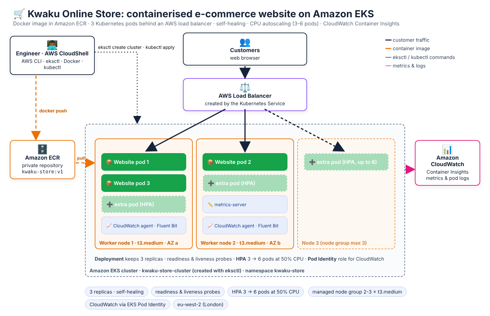
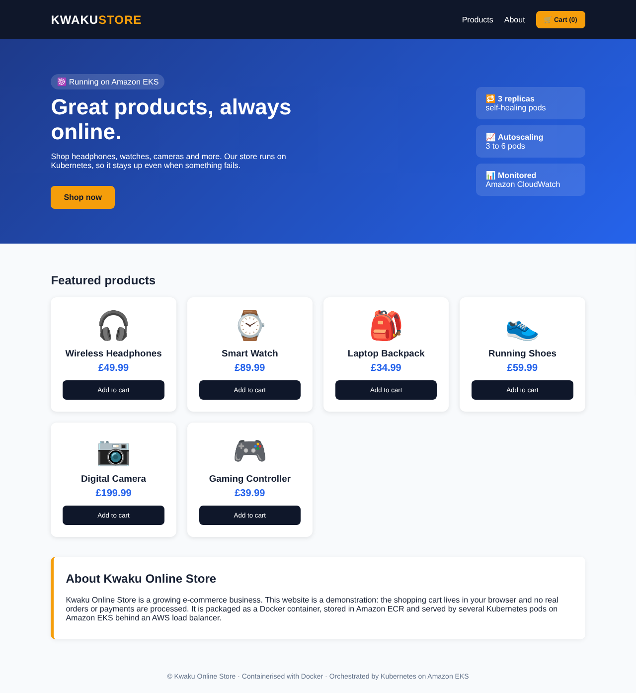
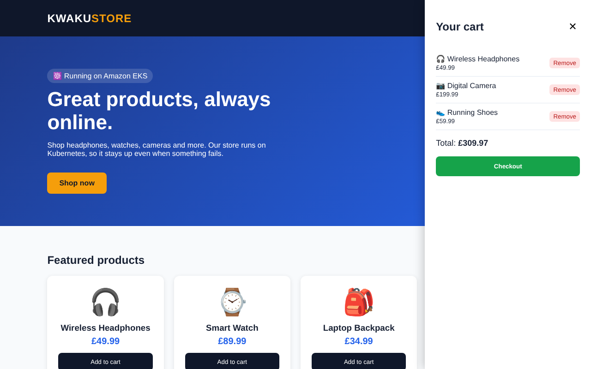

# 🛒 Containerised E-Commerce Website on AWS Kubernetes (Amazon EKS)


**Kwaku Online Store** is an online shop with a product catalogue and a shopping cart. In this project I packaged it with **Docker**, stored the image in **Amazon ECR** and deployed it to **Kubernetes on Amazon EKS**. The store:

- runs as **3 copies** (pods) behind an **AWS load balancer**,
- **replaces failed pods automatically**,
- **scales from 3 to 6 pods** when CPU usage rises,
- is monitored with **Amazon CloudWatch Container Insights**.

I built everything from the command line with the **AWS CLI, eksctl, Docker and kubectl** in AWS CloudShell.

---

## ⏱️ The project in 30 seconds

| | |
|---|---|
| **Business problem** | The store ran on one server: it **went down** when the application crashed, **slowed down** during promotions, and the IT team had to **restart it by hand** |
| **Solution** | Run the store as containers on Amazon EKS: several replicas, health checks, a load balancer, automatic pod replacement, CPU-based autoscaling and CloudWatch monitoring |
| **How it is proven** | Delete a running pod and watch Kubernetes replace it. Generate traffic and watch the autoscaler add pods. View metrics and logs in CloudWatch |
| **AWS services** | Amazon EKS, Amazon ECR, Amazon EC2 (managed node group), Elastic Load Balancing, Amazon VPC, IAM (EKS Pod Identity), Amazon CloudWatch |
| **Tools** | AWS CLI, eksctl, Docker, kubectl, Kubernetes YAML |
| **Skills** | Kubernetes, containers, orchestration, scaling, troubleshooting, monitoring, cost management |



| The store | Shopping cart |
|---|---|
|  |  |

---

## Contents

- [1. The business problem](#1-the-business-problem)
- [2. The solution and how it is proven](#2-the-solution-and-how-it-is-proven)
- [3. AWS services and tools](#3-aws-services-and-tools)
- [4. Project structure](#4-project-structure)
- [5. Step-by-step guide](#5-step-by-step-guide)
  - [Part 1: Prepare AWS CloudShell](#part-1-prepare-aws-cloudshell)
  - [Part 2: The e-commerce website](#part-2-the-e-commerce-website)
  - [Part 3: Containerise the website with Docker](#part-3-containerise-the-website-with-docker)
  - [Part 4: Push the image to Amazon ECR](#part-4-push-the-image-to-amazon-ecr)
  - [Part 5: Create the EKS cluster](#part-5-create-the-eks-cluster)
  - [Part 6: Deploy the website to Kubernetes](#part-6-deploy-the-website-to-kubernetes)
  - [Part 7: Make the website accessible to customers](#part-7-make-the-website-accessible-to-customers)
  - [Part 8: Test self-healing](#part-8-test-self-healing)
  - [Part 9: Configure autoscaling](#part-9-configure-autoscaling)
  - [Part 10: Test autoscaling](#part-10-test-autoscaling)
  - [Part 11: Monitor with Amazon CloudWatch](#part-11-monitor-with-amazon-cloudwatch)
  - [Part 12: Troubleshoot the application](#part-12-troubleshoot-the-application)
  - [Part 13: Capture evidence for your portfolio](#part-13-capture-evidence-for-your-portfolio)
  - [Part 14: Delete the AWS resources](#part-14-delete-the-aws-resources)
- [6. Cost](#6-cost)
- [7. Skills demonstrated](#7-skills-demonstrated)
- [8. For recruiters: project summary](#8-for-recruiters-project-summary)

---

## 1. The business problem

**Kwaku Online Store** is a growing e-commerce business that sells products online. It hosted its website on a **single server**, which caused three major problems:

| # | Problem | Impact on the business |
|---|---------|------------------------|
| 1 | **Website downtime**: when the application crashes, customers cannot reach the store | Lost sales and customer trust |
| 2 | **High customer traffic**: during promotions the single server cannot handle the visitors and the site slows down | Lost sales at the busiest, most valuable times |
| 3 | **Manual recovery**: the IT team restarts the application by hand whenever it fails | Slow recovery and wasted staff time |

**Example:** 1,000 customers visit during a Black Friday promotion.
- **Before Kubernetes:** if the one application server crashes, nobody can buy anything until the IT team restores it.
- **After Kubernetes:** the website runs as several pods. If one pod fails, the healthy pods keep serving customers while Kubernetes creates a replacement.

## 2. The solution and how it is proven

| Business problem | Kubernetes solution | Practical test in this project |
|------------------|---------------------|--------------------------------|
| Website crashes | A **Deployment** keeps 3 replicas running and **replaces failed pods** automatically. **Liveness probes** restart stuck containers | Part 8: delete a running pod and watch a new one start |
| High customer traffic | A **Horizontal Pod Autoscaler** adds pods (3 → 6) when CPU goes above 50% | Part 10: generate traffic and watch the pod count increase |
| Manual recovery | Kubernetes **self-healing**: nobody has to restart anything | Part 8: the store keeps answering while the pod is replaced |
| Single point of failure | **Multiple replicas** on **2 worker nodes** behind one **load balancer**. **Readiness probes** keep traffic away from unhealthy pods | Part 7: one public URL in front of all pods |
| Poor visibility | **CloudWatch Container Insights** for metrics, dashboards and pod logs | Part 11: view CPU, memory, pod health and logs |

> **Application recovery vs. infrastructure high availability:** pod self-healing protects against application failures. To also survive the loss of a node or a whole Availability Zone, the replicas must be spread over several nodes and zones. The managed node group runs in 2 AZs, and the Deployment asks Kubernetes to spread pods across nodes.

## 3. AWS services and tools

| Tool | Purpose |
|------|---------|
| **Amazon EKS** | Runs and manages the Kubernetes control plane |
| **Docker** | Packages the website and the NGINX web server into a container image |
| **Amazon ECR** | Private registry that stores the Docker image (scanned for vulnerabilities on push) |
| **Kubernetes** | Manages the application pods and replicas |
| **kubectl** | Command-line tool to control Kubernetes |
| **eksctl** | Creates and deletes the EKS cluster, VPC and node group (using AWS CloudFormation) |
| **AWS CLI** | Creates and manages the other AWS resources |
| **Kubernetes HPA** | Automatically adjusts the number of application pods |
| **Amazon CloudWatch** | Monitors performance and collects logs (Container Insights) |
| **EKS Pod Identity** | Gives the CloudWatch agent AWS permissions without storing keys |

## 4. Project structure

```
aws-eks-containerised-ecommerce/
├── website/                     # the online store
│   ├── index.html               # page structure: header, products, cart panel
│   ├── style.css                # design
│   ├── app.js                   # product catalogue and shopping cart logic
│   └── Dockerfile               # NGINX image + the website + a health check
├── k8s/                         # Kubernetes manifests
│   ├── namespace.yaml           # kwaku-store namespace
│   ├── deployment.yaml          # 3 replicas, resources, readiness and liveness probes
│   ├── service.yaml             # LoadBalancer Service (public AWS load balancer)
│   ├── hpa.yaml                 # Horizontal Pod Autoscaler: 3-6 pods at 50% CPU
│   └── load-generator.yaml      # test traffic for the autoscaling demo
├── iam/
│   └── cloudwatch-trust.json    # trust policy so EKS Pod Identity can use the CloudWatch role
├── scripts/
│   └── cleanup.sh               # deletes everything (Part 14) in one command
├── docs/images/                 # architecture diagram and website screenshots
└── screenshots/                 # your evidence from the AWS console (see Part 13)
```

---

## 5. Step-by-step guide

> ⚠️ **This project creates paid AWS resources:** the EKS control plane, EC2 instances, a load balancer and a NAT gateway (about **$0.30 per hour**, see [Cost](#6-cost)). It is **not** free-tier eligible. Use a personal lab account with a billing budget, and always complete [Part 14](#part-14-delete-the-aws-resources) when you finish.

### Part 1: Prepare AWS CloudShell

#### Step 1. Open AWS CloudShell

1. Sign in to the [AWS Management Console](https://console.aws.amazon.com/).
2. Select the Region **Europe (London) eu-west-2** at the top right.
3. Click the **CloudShell** icon (`>_`) at the top of the console.
4. Wait until the terminal opens. All the commands below run in CloudShell.

#### Step 2. Check your AWS account and set the project variables

```bash
aws sts get-caller-identity
aws configure get region
```

Set the project variables. You will use them in every step. **If CloudShell restarts, paste this block again.**

```bash
export AWS_REGION=eu-west-2
export CLUSTER_NAME=kwaku-store-cluster
export REPO_NAME=kwaku-store
export APP_NAME=kwaku-store

export AWS_ACCOUNT_ID=$(aws sts get-caller-identity \
  --query Account --output text)

export ECR_URI="${AWS_ACCOUNT_ID}.dkr.ecr.${AWS_REGION}.amazonaws.com/${REPO_NAME}"

echo "$AWS_ACCOUNT_ID"
echo "$ECR_URI"
```

#### Step 3. Check the installed tools

```bash
aws --version
docker --version
kubectl version --client
eksctl version
```

If `eksctl` is missing, install it:

```bash
ARCH=amd64
if [ "$(uname -m)" = "aarch64" ]; then
  ARCH=arm64
fi

curl --silent --location \
  "https://github.com/eksctl-io/eksctl/releases/latest/download/eksctl_Linux_${ARCH}.tar.gz" \
  -o /tmp/eksctl.tar.gz
tar -xzf /tmp/eksctl.tar.gz -C /tmp
sudo mv /tmp/eksctl /usr/local/bin/
eksctl version
```

Check that Docker works:

```bash
docker info
```

If Docker cannot connect to a running daemon, use a Docker-enabled environment such as an EC2 development instance for the image-build steps. Do not continue to the Docker build until `docker info` works.

### Part 2: The e-commerce website

The website is a lightweight online store with a **product catalogue**, a **shopping cart** and a **checkout demonstration**. It is static, so it does not take payments or store orders. This keeps the project focused on Kubernetes rather than application development.

#### Step 4. Get the project files

```bash
cd ~
git clone https://github.com/KwakuAdae/aws-eks-containerised-ecommerce.git
cd aws-eks-containerised-ecommerce
ls website k8s
```

#### Step 5. The website HTML: [`website/index.html`](website/index.html)

This file holds the structure of the store: the header with the **Cart** button, the hero banner, the product area, the About section and the slide-in cart panel.

```html
<header>
  <div class="brand">KWAKU<span>STORE</span></div>
  <nav>
    <a href="#products">Products</a>
    <a href="#about">About</a>
    <button id="cart-button" type="button">🛒 Cart (<span id="cart-count">0</span>)</button>
  </nav>
</header>
...
<div id="product-grid" class="product-grid"></div>   <!-- filled in by app.js -->
```

#### Step 6. The CSS: [`website/style.css`](website/style.css)

This file controls the design: the dark header, the blue hero banner, the product cards in a responsive grid, and the cart panel that slides in from the right. It also adjusts the layout for mobile phones.

#### Step 7. The JavaScript: [`website/app.js`](website/app.js)

This file holds the product catalogue and the cart logic:

```javascript
const products = [
  { id: 1, name: "Wireless Headphones", price: 49.99, icon: "🎧" },
  { id: 2, name: "Smart Watch",         price: 89.99, icon: "⌚" },
  { id: 3, name: "Laptop Backpack",     price: 34.99, icon: "🎒" },
  { id: 4, name: "Running Shoes",       price: 59.99, icon: "👟" },
  { id: 5, name: "Digital Camera",      price: 199.99, icon: "📷" },
  { id: 6, name: "Gaming Controller",   price: 39.99, icon: "🎮" }
];
```

It draws a card for each product, adds and removes items in the cart, keeps the total up to date and shows a demo checkout message. The cart lives in the visitor's browser and is not stored in a database. That is fine for a Kubernetes demonstration, because any pod can serve any visitor.

### Part 3: Containerise the website with Docker

#### Step 8. The Dockerfile: [`website/Dockerfile`](website/Dockerfile)

```dockerfile
FROM public.ecr.aws/nginx/nginx:stable-alpine

COPY index.html /usr/share/nginx/html/index.html
COPY style.css /usr/share/nginx/html/style.css
COPY app.js /usr/share/nginx/html/app.js

EXPOSE 80

HEALTHCHECK --interval=30s --timeout=3s \
  CMD wget -q -O /dev/null http://127.0.0.1/ || exit 1
```

**In simple words:** Docker packages the website together with an NGINX web server into an image that runs the same way on your laptop, in CloudShell and on Kubernetes. The official NGINX image comes from **Amazon ECR Public**, which avoids Docker Hub download limits.

#### Step 9. Build the Docker image

```bash
docker build -t kwaku-store:v1 website/
docker images
```

You should see `kwaku-store` with the tag `v1` in the list.

#### Step 10. Test the website locally

```bash
docker run -d \
  --name kwaku-store-test \
  -p 8080:80 \
  kwaku-store:v1

curl -I http://localhost:8080
```

Expected response:

```
HTTP/1.1 200 OK
```

Stop the test container:

```bash
docker rm -f kwaku-store-test
```

### Part 4: Push the image to Amazon ECR

#### Step 11. Create an ECR repository

```bash
aws ecr create-repository \
  --repository-name "$REPO_NAME" \
  --image-scanning-configuration scanOnPush=true \
  --region "$AWS_REGION"
```

This creates a **private** repository for the container image. Every pushed image is scanned for known vulnerabilities.

#### Step 12. Authenticate Docker to ECR

```bash
aws ecr get-login-password \
  --region "$AWS_REGION" \
| docker login \
  --username AWS \
  --password-stdin \
  "${AWS_ACCOUNT_ID}.dkr.ecr.${AWS_REGION}.amazonaws.com"
```

Expected output: `Login Succeeded`

#### Step 13. Tag the Docker image

```bash
docker tag kwaku-store:v1 "${ECR_URI}:v1"
```

#### Step 14. Push the image

```bash
docker push "${ECR_URI}:v1"
```

Check that AWS received the image:

```bash
aws ecr describe-images \
  --repository-name "$REPO_NAME" \
  --region "$AWS_REGION"
```

You can also open the console: **Elastic Container Registry → Repositories → kwaku-store**. 📸 *Screenshot: the `v1` image in ECR.*

### Part 5: Create the EKS cluster

#### Step 15. Create the cluster with eksctl (15-30 minutes)

We will create a Kubernetes cluster with two EC2 worker nodes.

```bash
eksctl create cluster \
  --name "$CLUSTER_NAME" \
  --region "$AWS_REGION" \
  --nodegroup-name store-workers \
  --node-type t3.medium \
  --nodes 2 \
  --nodes-min 2 \
  --nodes-max 3 \
  --managed
```

**What this command does:**

- Creates an Amazon EKS Kubernetes cluster.
- Creates a VPC with public and private subnets across Availability Zones, and a NAT gateway.
- Creates a **managed node group** with two `t3.medium` EC2 instances (it can grow to 3).
- Configures the IAM roles the cluster and nodes need.
- Installs the required Kubernetes networking add-ons (VPC CNI, CoreDNS, kube-proxy).

`eksctl` uses **AWS CloudFormation** to create these resources. You can follow progress in **CloudFormation → Stacks**.

#### Step 16. Connect kubectl to the cluster

```bash
aws eks update-kubeconfig \
  --region "$AWS_REGION" \
  --name "$CLUSTER_NAME"
```

This tells `kubectl` which Kubernetes cluster to manage. (`eksctl` already does this for you, but the command is useful when you open a new CloudShell session.)

#### Step 17. Check the Kubernetes nodes

```bash
kubectl get nodes -o wide
```

You should see two nodes with the status `Ready` (the names will be different):

```
NAME                                          STATUS   ROLES    AGE   VERSION
ip-192-168-12-34.eu-west-2.compute.internal   Ready    <none>   5m    v1.xx
ip-192-168-56-78.eu-west-2.compute.internal   Ready    <none>   5m    v1.xx
```

**In simple words:**

- **EKS cluster** = the Kubernetes environment.
- **Node** = an EC2 computer that runs applications.
- **Pod** = the Kubernetes unit that contains our website container.

📸 *Screenshot: `kubectl get nodes`.*

#### Step 18. Check the Kubernetes system pods

```bash
kubectl get pods -n kube-system
```

You should see system components such as **CoreDNS**, **kube-proxy** and **aws-node** (the VPC CNI). They handle networking and cluster operations.

### Part 6: Deploy the website to Kubernetes

#### Step 19. Create a namespace

```bash
kubectl apply -f k8s/namespace.yaml
kubectl get namespaces
```

A **namespace** organises related resources inside Kubernetes. Everything for the store lives in `kwaku-store`.

#### Step 20. The Kubernetes Deployment: [`k8s/deployment.yaml`](k8s/deployment.yaml)

This is one of the most important parts of the project. The Deployment tells Kubernetes:

- **which Docker image** to run,
- **how many copies** of the website to keep,
- **how much CPU and memory** each container needs,
- **how to check** whether the website is healthy.

```yaml
spec:
  replicas: 3
  ...
      containers:
        - name: kwaku-store
          image: IMAGE_URI                 # replaced with ${ECR_URI}:v1 in step 21
          resources:
            requests: { cpu: 100m, memory: 64Mi }
            limits:   { cpu: 250m, memory: 128Mi }
          readinessProbe:
            httpGet: { path: /, port: 80 }
          livenessProbe:
            httpGet: { path: /, port: 80 }
```

- `replicas: 3` means Kubernetes keeps **three running copies** of the website. If one pod fails, Kubernetes replaces it.
- The **readiness probe** stops an unhealthy pod from receiving traffic.
- The **liveness probe** lets Kubernetes detect and restart an unresponsive container.
- The CPU **request** is what the autoscaler measures against in Part 9.

#### Step 21. Deploy the website

The command below puts your ECR image into the manifest and sends it to Kubernetes:

```bash
sed "s|IMAGE_URI|${ECR_URI}:v1|" k8s/deployment.yaml | kubectl apply -f -
```

Check the Deployment and the pods:

```bash
kubectl get deployments -n kwaku-store
kubectl get pods -n kwaku-store -o wide
```

Wait until the Deployment is ready:

```bash
kubectl rollout status \
  deployment/kwaku-store \
  -n kwaku-store \
  --timeout=10m
```

You should see **three running pods**, spread over the two nodes. 📸 *Screenshot: `kubectl get pods -n kwaku-store -o wide`.*

### Part 7: Make the website accessible to customers

#### Step 22. The LoadBalancer Service: [`k8s/service.yaml`](k8s/service.yaml)

The website runs inside Kubernetes, but customers cannot reach it from the internet yet. A Service of type `LoadBalancer` fixes that:

```yaml
apiVersion: v1
kind: Service
metadata:
  name: kwaku-store-service
  namespace: kwaku-store
spec:
  type: LoadBalancer
  selector:
    app: kwaku-store
  ports:
    - name: http
      protocol: TCP
      port: 80
      targetPort: 80
```

#### Step 23. Deploy the Service

```bash
kubectl apply -f k8s/service.yaml
kubectl get svc -n kwaku-store
```

AWS creates a public load balancer for this Service. This can take a few minutes.

#### Step 24. Find your website address

```bash
kubectl get svc kwaku-store-service \
  -n kwaku-store
```

Look at the `EXTERNAL-IP` column. For an AWS load balancer this is a DNS hostname, not an IP address. Save it in a variable:

```bash
export STORE_URL=$(kubectl get svc \
  kwaku-store-service \
  -n kwaku-store \
  -o jsonpath='{.status.loadBalancer.ingress[0].hostname}')

echo "http://${STORE_URL}"
```

Open the displayed URL in your browser. You should see **Kwaku Online Store** with its products and shopping cart. If it does not load yet, wait 2-3 minutes for DNS. 📸 *Screenshot: the store in your browser.*

> This project uses HTTP for simplicity. A production e-commerce website needs HTTPS, a domain name and more security controls.

#### Step 25. Test the website

```bash
curl -I "http://${STORE_URL}"
```

Expected:

```
HTTP/1.1 200 OK
```

You have now deployed a Docker containerised website to Kubernetes on AWS. 🎉

### Part 8: Test self-healing

This part directly addresses the business problem of **application failures** and **manual recovery**.

#### Step 26. Check the running pods

```bash
kubectl get pods -n kwaku-store
```

You should see three running pods.

#### Step 27. Delete one pod deliberately

Open a **second CloudShell tab** (**Actions → New tab**) and run `kubectl get pods -n kwaku-store -w` there, so you can watch live. Then, in the first tab:

```bash
POD_NAME=$(kubectl get pods \
  -n kwaku-store \
  -l app=kwaku-store \
  -o jsonpath='{.items[0].metadata.name}')

echo "$POD_NAME"

kubectl delete pod "$POD_NAME" \
  -n kwaku-store
```

While this happens, the store keeps answering. Check it in the first tab:

```bash
for i in $(seq 10); do curl -s -o /dev/null -w "%{http_code}\n" "http://${STORE_URL}"; sleep 1; done
```

#### Step 28. Watch Kubernetes recover

```bash
kubectl get pods -n kwaku-store -w
```

The deleted pod shows `Terminating`, and a **new pod** with a new name appears and becomes `Running`. Press `Ctrl + C` to stop watching.

**What you have demonstrated:** Kubernetes automatically replaces failed or deleted application pods, so nobody has to restart the application by hand. 📸 *Screenshot: the old pod terminating and the new pod becoming ready.*

### Part 9: Configure autoscaling

We want Kubernetes to add website pods when CPU demand rises.

#### Step 29. Install Metrics Server

First check whether Metrics Server is already installed:

```bash
kubectl get deployment metrics-server \
  -n kube-system
```

If it is not installed, use the EKS managed add-on:

```bash
aws eks create-addon \
  --cluster-name "$CLUSTER_NAME" \
  --addon-name metrics-server \
  --region "$AWS_REGION"
```

Check its status, and wait for `ACTIVE`:

```bash
aws eks describe-addon \
  --cluster-name "$CLUSTER_NAME" \
  --addon-name metrics-server \
  --region "$AWS_REGION" \
  --query 'addon.status' \
  --output text
```

Then check that metrics are available:

```bash
kubectl top nodes
kubectl top pods -n kwaku-store
```

Metrics Server supplies the CPU and memory usage information that the Horizontal Pod Autoscaler needs.

#### Step 30. The Horizontal Pod Autoscaler: [`k8s/hpa.yaml`](k8s/hpa.yaml)

```yaml
apiVersion: autoscaling/v2
kind: HorizontalPodAutoscaler
metadata:
  name: kwaku-store-hpa
  namespace: kwaku-store
spec:
  scaleTargetRef:
    apiVersion: apps/v1
    kind: Deployment
    name: kwaku-store
  minReplicas: 3
  maxReplicas: 6
  metrics:
    - type: Resource
      resource:
        name: cpu
        target:
          type: Utilization
          averageUtilization: 50
```

This configuration means:

- Minimum: **3** website pods.
- Maximum: **6** website pods.
- CPU target: **50%** of the requested CPU per pod.

Kubernetes adjusts the replica count based on observed CPU use. It does not guarantee a specific number of pods for every traffic level.

#### Step 31. Apply the HPA

```bash
kubectl apply -f k8s/hpa.yaml
kubectl get hpa -n kwaku-store
```

Expected structure (the CPU percentage will vary):

```
NAME              REFERENCE                TARGETS       MINPODS   MAXPODS   REPLICAS
kwaku-store-hpa   Deployment/kwaku-store   cpu: 2%/50%   3         6         3
```

### Part 10: Test autoscaling

For this test, we put CPU pressure on the application pods.

#### Step 32. Generate test traffic

[`k8s/load-generator.yaml`](k8s/load-generator.yaml) starts **3 load-generator pods**. Each one requests the website non-stop through the internal Kubernetes Service:

```bash
kubectl apply -f k8s/load-generator.yaml
kubectl get pods -n kwaku-store -l app=load-generator
```

#### Step 33. Watch the autoscaler

```bash
kubectl get hpa -n kwaku-store -w
```

After 1-2 minutes, the CPU target should climb above 50% and the HPA should request more replicas. Press `Ctrl + C`, then watch the pods:

```bash
kubectl get pods -n kwaku-store -l app=kwaku-store -w
```

📸 *Screenshot: `kubectl get hpa` showing more than 3 replicas.*

> **Important:**
> - **If the CPU stays below 50%:** add more load with `kubectl scale deployment load-generator -n kwaku-store --replicas=6`.
> - **If new pods stay `Pending`:** the two nodes may be full, because the HPA can request more pods than the nodes have room for. Check `kubectl describe pod <pod> -n kwaku-store`.
> - **Only claim what you saw:** do not say autoscaling succeeded unless the HPA and pod counts actually showed it.

#### Step 34. Stop the load test

```bash
kubectl delete -f k8s/load-generator.yaml --ignore-not-found
```

Check the HPA again:

```bash
kubectl get hpa -n kwaku-store
```

After the CPU usage drops and the scale-down stabilisation period passes (about 5 minutes), Kubernetes reduces the replicas back to 3.

### Part 11: Monitor with Amazon CloudWatch

CloudWatch helps the IT team monitor the Kubernetes environment and investigate failures. We install the **CloudWatch Observability add-on** with **EKS Pod Identity**, so that the monitoring agent can securely send logs and metrics to AWS without stored access keys.

#### Step 35. Install the EKS Pod Identity agent

Check whether it is installed:

```bash
aws eks describe-addon \
  --cluster-name "$CLUSTER_NAME" \
  --addon-name eks-pod-identity-agent \
  --region "$AWS_REGION"
```

If it is not installed:

```bash
aws eks create-addon \
  --cluster-name "$CLUSTER_NAME" \
  --addon-name eks-pod-identity-agent \
  --region "$AWS_REGION"

aws eks wait addon-active \
  --cluster-name "$CLUSTER_NAME" \
  --addon-name eks-pod-identity-agent \
  --region "$AWS_REGION"
```

#### Step 36. Create the CloudWatch IAM role

The trust policy [`iam/cloudwatch-trust.json`](iam/cloudwatch-trust.json) allows EKS Pod Identity to give this role to a pod:

```json
{
  "Version": "2012-10-17",
  "Statement": [
    {
      "Effect": "Allow",
      "Principal": { "Service": "pods.eks.amazonaws.com" },
      "Action": ["sts:AssumeRole", "sts:TagSession"]
    }
  ]
}
```

Create the IAM role:

```bash
aws iam create-role \
  --role-name KwakuStoreCloudWatchRole \
  --assume-role-policy-document file://iam/cloudwatch-trust.json
```

Attach the required monitoring policies:

```bash
aws iam attach-role-policy \
  --role-name KwakuStoreCloudWatchRole \
  --policy-arn arn:aws:iam::aws:policy/CloudWatchAgentServerPolicy

aws iam attach-role-policy \
  --role-name KwakuStoreCloudWatchRole \
  --policy-arn arn:aws:iam::aws:policy/AWSXrayWriteOnlyAccess
```

#### Step 37. Install the CloudWatch Observability add-on

```bash
aws eks create-addon \
  --cluster-name "$CLUSTER_NAME" \
  --addon-name amazon-cloudwatch-observability \
  --pod-identity-associations \
"serviceAccount=cloudwatch-agent,roleArn=arn:aws:iam::${AWS_ACCOUNT_ID}:role/KwakuStoreCloudWatchRole" \
  --region "$AWS_REGION"
```

Check its status, and wait for `ACTIVE`:

```bash
aws eks describe-addon \
  --cluster-name "$CLUSTER_NAME" \
  --addon-name amazon-cloudwatch-observability \
  --region "$AWS_REGION" \
  --query 'addon.status' \
  --output text
```

#### Step 38. Check the monitoring pods

```bash
kubectl get pods -n amazon-cloudwatch
```

You should see the CloudWatch agent and Fluent Bit (log collection) pods running on each node.

#### Step 39. View logs and metrics

Open the [Amazon CloudWatch console](https://console.aws.amazon.com/cloudwatch/), select the **London** Region and go to **CloudWatch → Insights → Container Insights**. Select the cluster `kwaku-store-cluster` and explore CPU use, memory use, pod health and container performance. 📸 *Screenshot: the Container Insights dashboard.*

The pod logs are also stored in CloudWatch Logs:

```bash
aws logs describe-log-groups \
  --log-group-name-prefix "/aws/containerinsights/${CLUSTER_NAME}/" \
  --region "$AWS_REGION" \
  --query 'logGroups[].logGroupName'
```

You can also read the application logs directly with the CLI:

```bash
kubectl logs deployment/kwaku-store \
  -n kwaku-store \
  --tail=30
```

For logs from every website pod:

```bash
kubectl logs \
  -l app=kwaku-store \
  -n kwaku-store \
  --all-containers=true \
  --prefix=true \
  --tail=30
```

### Part 12: Troubleshoot the application

These commands help when Kubernetes resources do not behave as expected:

| Command | What it tells you |
|---------|-------------------|
| `kubectl get nodes` | Whether the EC2 worker nodes are ready |
| `kubectl get pods -n kwaku-store` | Whether the website pods are running |
| `kubectl describe pods -n kwaku-store` | Why a pod is failing (see **Events** at the bottom) |
| `kubectl logs -l app=kwaku-store -n kwaku-store` | What the web server is logging |
| `kubectl get events -n kwaku-store --sort-by=.lastTimestamp` | Everything that happened recently, newest last |
| `kubectl get svc -n kwaku-store` | Whether the website has a load balancer |
| `kubectl get hpa -n kwaku-store` | Whether autoscaling is configured and receiving metrics |
| `kubectl top pods -n kwaku-store` | CPU and memory per pod |

| Symptom | Likely cause and fix |
|---------|----------------------|
| Pod stuck in `ImagePullBackOff` | Check the image URI in the Deployment (`kubectl describe pod`) and that the image exists in ECR (Step 14). The worker nodes must be able to pull from ECR |
| Pod stuck in `Pending` | The nodes have no free CPU or memory. Check `kubectl describe pod` and `kubectl top nodes` |
| `EXTERNAL-IP` shows `<pending>` | The load balancer is still being created. Wait a few minutes and check `kubectl describe svc kwaku-store-service -n kwaku-store` |
| Website unreachable | Check the load balancer, its security groups, the Service endpoints (`kubectl get endpoints -n kwaku-store`) and pod readiness |
| HPA shows `<unknown>/50%` | Metrics Server is not ready yet (Step 29), or the pods have no CPU request |
| `kubectl`: `You must be logged in to the server` | Run `aws eks update-kubeconfig` (Step 16) with the same identity that created the cluster |
| Variables are empty after a CloudShell restart | Paste the variables block from Step 2 again |

### Part 13: Capture evidence for your portfolio

Before you delete the resources, collect evidence that your project works. Save screenshots in [`screenshots/`](screenshots/) (that folder lists exactly what to capture).

**Project completion checklist:**

- [ ] Website loads through the public AWS load balancer
- [ ] Docker image is visible in Amazon ECR
- [ ] Two EC2 worker nodes show `Ready`
- [ ] Three website pods are running
- [ ] A deleted pod is automatically replaced
- [ ] HPA is configured and CPU metrics are available
- [ ] Autoscaling is demonstrated (if sufficient load and capacity are available)
- [ ] CloudWatch shows cluster metrics and logs
- [ ] Screenshots and YAML files are saved for GitHub

#### Step 40. Save your Kubernetes configuration

The configuration you used is already in this repository: [`website/`](website/), [`k8s/`](k8s/) and [`iam/`](iam/). Always inspect files before publishing them. They contain no secrets, and your account ID only appears in your terminal, not in the files.

#### Step 41. Write up your results

Add your own results to your copy of this README: your screenshots, how long the replacement pod took to become ready, and the highest replica count you saw during the load test.

### Part 14: Delete the AWS resources

**Very important:** Amazon EKS, EC2 instances, load balancers and NAT gateways keep costing money until they are deleted. **Do not delete the VPC or its subnets by hand before deleting the EKS cluster.**

**Quick option:** run every step below with one command:

```bash
./scripts/cleanup.sh
```

Or run the steps one by one:

#### Step 42. Delete the load generator if it still exists

```bash
kubectl delete -f k8s/load-generator.yaml --ignore-not-found
```

#### Step 43. Delete the public load balancer

```bash
kubectl delete service kwaku-store-service \
  -n kwaku-store \
  --wait=true

kubectl get svc -n kwaku-store
```

Allow a minute or two for AWS to finish deleting the load balancer.

#### Step 44. Delete the website resources

```bash
kubectl delete -f k8s/hpa.yaml --ignore-not-found
kubectl delete deployment kwaku-store -n kwaku-store --ignore-not-found
kubectl delete -f k8s/namespace.yaml --ignore-not-found
```

#### Step 45. Delete the EKS cluster

```bash
eksctl delete cluster \
  --name "$CLUSTER_NAME" \
  --region "$AWS_REGION" \
  --wait
```

This removes the EKS cluster and the resources `eksctl` created, including the managed node group, the VPC and NAT gateway, the add-ons and the CloudFormation stacks. It can take 15-20 minutes.

#### Step 46. Delete the ECR repository

Once you have saved your project files and screenshots:

```bash
aws ecr delete-repository \
  --repository-name "$REPO_NAME" \
  --region "$AWS_REGION" \
  --force
```

This also deletes the images stored in the repository.

#### Step 47. Delete the CloudWatch IAM role and log groups

Detach its policies, then delete the role:

```bash
aws iam detach-role-policy \
  --role-name KwakuStoreCloudWatchRole \
  --policy-arn arn:aws:iam::aws:policy/CloudWatchAgentServerPolicy

aws iam detach-role-policy \
  --role-name KwakuStoreCloudWatchRole \
  --policy-arn arn:aws:iam::aws:policy/AWSXrayWriteOnlyAccess

aws iam delete-role \
  --role-name KwakuStoreCloudWatchRole
```

If the role cannot be deleted, check that the cluster and its Pod Identity associations have been removed.

Retained logs keep costing a little for storage. Delete the Container Insights log groups:

```bash
for group in $(aws logs describe-log-groups \
    --log-group-name-prefix "/aws/containerinsights/${CLUSTER_NAME}/" \
    --region "$AWS_REGION" --query 'logGroups[].logGroupName' --output text); do
  aws logs delete-log-group --log-group-name "$group" --region "$AWS_REGION"
done
```

#### Step 48. Verify the cleanup

Check EKS:

```bash
aws eks list-clusters \
  --region "$AWS_REGION"
```

Check load balancers (Classic, and Application/Network):

```bash
aws elb describe-load-balancers \
  --region "$AWS_REGION" \
  --query 'LoadBalancerDescriptions[*].[LoadBalancerName]' \
  --output table

aws elbv2 describe-load-balancers \
  --region "$AWS_REGION" \
  --query 'LoadBalancers[*].[LoadBalancerName,State.Code]' \
  --output table
```

Check remaining CloudFormation stacks:

```bash
aws cloudformation list-stacks \
  --region "$AWS_REGION" \
  --stack-status-filter CREATE_COMPLETE UPDATE_COMPLETE DELETE_FAILED \
  --query "StackSummaries[?contains(StackName, 'kwaku-store-cluster')].[StackName,StackStatus]" \
  --output table
```

Also look in the console at **EC2 instances**, **VPCs**, **NAT gateways**, **CloudWatch log groups** and the **Billing dashboard** for anything left behind. Do not delete resources that belong to other projects.

---

## 6. Cost

| Resource | Approximate price (eu-west-2) |
|----------|-------------------------------|
| EKS control plane | $0.10 per hour |
| 2 × t3.medium EC2 nodes | About $0.05 per hour each |
| NAT gateway (created by eksctl) | About $0.05 per hour + data processed |
| Classic Load Balancer | About $0.03 per hour + data |
| ECR storage, CloudWatch metrics and logs | A few cents for this project |

Expect roughly **$0.30 per hour**: a 3-hour session costs about **$1**. Leaving it running for a month would cost over **$200**, so **always complete Part 14**. You can set a spending alert in **Billing → Budgets**.

## 7. Skills demonstrated

| Area | Evidence in this project |
|------|--------------------------|
| **Kubernetes administration** | EKS cluster with eksctl, managed node group, kubeconfig, namespaces, system pods |
| **Containers** | Dockerfile, NGINX, local container testing, image tagging, Amazon ECR with scan on push |
| **Kubernetes workloads** | Deployment with replicas, resource requests and limits, readiness and liveness probes, LoadBalancer Service |
| **Self-healing** | Deleted a running pod and watched Kubernetes create a replacement |
| **Scaling** | Metrics Server, Horizontal Pod Autoscaler (3-6 pods at 50% CPU), load testing |
| **Monitoring** | CloudWatch Container Insights, CloudWatch Logs, `kubectl top`, `kubectl logs` |
| **Security** | Private ECR repository, image scanning, IAM role through EKS Pod Identity (no stored keys) |
| **Troubleshooting** | `kubectl describe`, events, logs, a symptom → cause → fix table |
| **Cost management** | Ordered cleanup with verification, cost estimate, cleanup script |

## 8. For recruiters: project summary

> **AWS EKS Containerised E-Commerce Website**
>
> **Business problem:** An online retail business experienced application downtime, limited scalability during peak demand, and manual recovery procedures.
>
> **Solution:** I designed and deployed a Kubernetes-based hosting environment on Amazon EKS with multiple website replicas, health checks, load balancing, CPU-based autoscaling and Amazon CloudWatch monitoring. I built it with the AWS CLI, eksctl, Docker and kubectl.
>
> **Key features:**
> - Containerised e-commerce website (NGINX + HTML/CSS/JavaScript) stored in Amazon ECR
> - Three application replicas behind a public AWS load balancer
> - Readiness and liveness probes, resource requests and limits
> - Kubernetes pod self-healing: deleted pods are replaced automatically
> - CPU-based Horizontal Pod Autoscaling from 3 to 6 pods
> - Centralised monitoring and logs with CloudWatch Container Insights, using EKS Pod Identity
>
> **Business value:** The solution shows how Kubernetes improves application resilience, automates recovery and adjusts capacity to demand.
>
> **Technologies:** Amazon EKS, Docker, NGINX, Kubernetes, kubectl, AWS CLI, eksctl, Kubernetes HPA, Amazon ECR, Amazon CloudWatch, IAM.

**How to explain it in an interview:**

> "I built this project to solve an e-commerce business problem: application downtime, limited scalability and manual recovery. I used Amazon EKS, Docker and Kubernetes to deploy multiple website replicas. I configured automatic pod recovery and CPU-based autoscaling, and I monitored application performance with Amazon CloudWatch."

| Project summary | |
|---|---|
| Project | Kwaku Online Store |
| Cloud provider | Amazon Web Services |
| Platform | Amazon EKS |
| Deployment method | CLI + Kubernetes YAML |
| Initial replicas | 3 pods |
| Autoscaling range | 3-6 pods |

## Related projects

- [aws-eks-kubernetes-store-cli](https://github.com/KwakuAdae/aws-eks-kubernetes-store-cli): the same store on EKS Auto Mode, with automated self-healing, autoscaling and rolling-update tests
- [aws-high-availability-store-cli](https://github.com/KwakuAdae/aws-high-availability-store-cli): the store on EC2 with an Application Load Balancer and Auto Scaling
- [aws-cloud-monitoring-cloudformation](https://github.com/KwakuAdae/aws-cloud-monitoring-cloudformation): CloudWatch monitoring with CloudFormation
- [aws-jenkins-cicd-terraform](https://github.com/KwakuAdae/aws-jenkins-cicd-terraform): CI/CD pipeline for the store with Jenkins and Terraform

## Author

**Kwaku Adae**: [github.com/KwakuAdae](https://github.com/KwakuAdae)

## License

[MIT](LICENSE)
